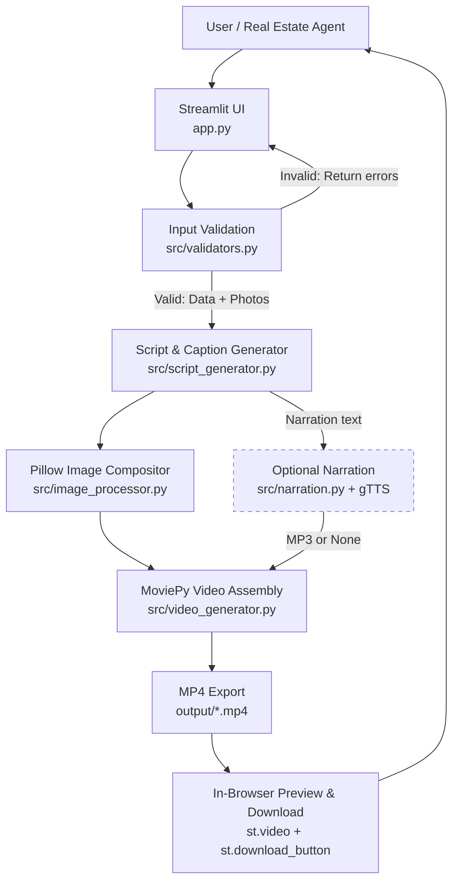

# 🏡 AI Property Video Generator

[](https://iamujjwal69-ai-property-video-generator-app-5x9ux2.streamlit.app/)
[](https://www.python.org/)
[](https://opensource.org/licenses/MIT)
[](https://peps.python.org/pep-0008/)

> **Live Demo:** [https://iamujjwal69-ai-property-video-generator-app-5x9ux2.streamlit.app/](https://iamujjwal69-ai-property-video-generator-app-5x9ux2.streamlit.app/)  
> **Source Code:** [https://github.com/iamujjwal69/AI-Property-Video-Generator](https://github.com/iamujjwal69/AI-Property-Video-Generator)

---

## 📌 Architectural & Transparency Notice (API & Model Disclosure)

> **Honesty & Integrity Statement:**  
> **No generative AI model (such as OpenAI GPT, Claude, or Midjourney) is used in this application.**
> 
> * **Caption & Script Generation:** 100% deterministic, rule-based string templates populated solely by the exact facts typed into the form by the user. This guarantees **zero hallucinations**, predictable timelines, and complete local data privacy.
> * **Voiceover Narration:** Synthesized using **Google Text-to-Speech (`gTTS`)**, which is strictly **optional**. If an internet connection is unavailable or the service times out, the application catches the error gracefully, displays a non-blocking notification, and still produces a clean, silent promotional video.
> * **Paid APIs / Subscriptions:** **Zero.** There are no paid APIs, external database servers, third-party authentication services, or recurring cloud costs required to run or deploy this software.

---

## 📖 Project Overview

The **AI Property Video Generator** is a modular Python monolith designed for real estate agents, property brokers, and property owners. It takes listing facts (property name, location, price, property type, amenities, and contact call-to-action) alongside 4–8 photographs, and synthesizes a high-definition (**1280×720 HD, 24 fps**), promotional MP4 video strictly within **20 to 30 seconds**.

### Core Design Philosophy
Instead of relying on fragile external software like ImageMagick or MoviePy `TextClip` (which often crash across different operating systems), **every video scene is composed as a high-resolution still frame directly in Pillow (PIL)**. MoviePy is strictly reserved for timeline management, smooth crossfades, audio multiplexing, and final H.264/AAC encoding.

---

## 🏗️ System Architecture



---

## ✨ Features

- **🛡️ Strict Input Gatekeeper (`src/validators.py`):** Validates required strings, lenient currency formats (`INR 85,00,000`, `$450,000`, `₹75 Lakh`), photo counts (strictly 4–8 images), image formats (`jpg`, `jpeg`, `png`, `webp`), and minimum resolution thresholds (400×300 px).
- **⏱️ Deterministic Scene Timing (`src/script_generator.py`):** Automatically computes per-photo display durations (2.2s – 3.5s) to guarantee the final video duration is always between 20.0 and 30.0 seconds.
- **🎨 Cinematic Frame Compositing (`src/image_processor.py`):**
  - **No Black Bars:** Background is filled with a blurred, darkened replica of the photo.
  - **Aspect-Ratio Preservation:** Original photos are thumbnail-fitted without cropping or geometric distortion.
  - **Glassmorphism Overlays:** Semi-transparent dark badges, accent dividers, scene counters (`Photo 1 of 5`), and emerald price pills.
  - **Bundled Fonts:** Uses bundled TrueType font (`assets/font.ttf`) with drop-shadow effects for universal font rendering across Windows, Linux, and macOS.
- **🎬 MoviePy & FFmpeg Assembly (`src/video_generator.py`):** Seamless `0.4s` crossfade transitions, audio sync, and lightweight encoding via `preset="ultrafast"`.
- **⚡ Automatic Resource Cleanup (`src/utils.py`):** Isolated temporary directories (`temp/run_YYYYMMDD_HHMMSS/`) are automatically purged in `finally` blocks upon completion or failure.
- **🚀 One-Click Demo Mode:** Sidebar button loads full sample property data and bundled photos with zero typing required.

---

## 🛠️ Tech Stack & Dependencies

| Library / Tool | Version | Purpose & Justification |
|---|---|---|
| **Python** | `3.10 – 3.12` | Core programming language monolith. |
| **Streamlit** | `>=1.36.0` | Modern reactive UI: form widgets, progress feedback, embedded video player, and file downloads. |
| **Pillow (PIL)** | `>=10.4.0` | Image verification, EXIF rotation, blurred letterboxing, typography, and badge compositing. |
| **MoviePy** | `1.0.3` / `2.x` | Concatenation, fade transitions, audio muxing, and video timeline management. |
| **imageio-ffmpeg** | `>=0.5.1` | Supplies a static, self-contained FFmpeg binary when no system FFmpeg exists. |
| **gTTS** | `>=2.5.0` | *(Optional)* Free text-to-speech engine for spoken narration. Gracefully degrades if offline. |
| **Pytest** | `>=8.0.0` | Automated test suite for pure business logic (validation and timing constraints). |

---

## 📋 Prerequisites

* **Python 3.10, 3.11, or 3.12** installed on your system.
* **FFmpeg:** Automatically supplied by `imageio-ffmpeg` (bundled in `requirements.txt`). On Linux servers, `ffmpeg` can also be installed via apt (`packages.txt`).

---

## 💻 Local Setup & Installation

### 1. Clone the Repository
```bash
git clone https://github.com/iamujjwal69/AI-Property-Video-Generator.git
cd AI-Property-Video-Generator
```

### 2. Create and Activate a Virtual Environment
- **Windows (PowerShell):**
  ```powershell
  python -m venv .venv
  .venv\Scripts\Activate.ps1
  ```
- **Windows (Command Prompt):**
  ```cmd
  python -m venv .venv
  .venv\Scripts\activate.bat
  ```
- **macOS / Linux:**
  ```bash
  python3 -m venv .venv
  source .venv/bin/activate
  ```

### 3. Install Dependencies
```bash
pip install -r requirements.txt
```

---

## 🚀 How to Run

### Mode 1: Streamlit Web Application (Recommended)
```bash
streamlit run app.py
```
Open your browser and navigate to: **`http://localhost:8501`**

#### Using the Web UI:
1. Click **"✨ Load Sample Property Data"** in the sidebar to populate instant demo data.
2. Check the box **"Use 5 Bundled Sample Images"** (or upload your own 4 to 8 photos).
3. Toggle narration on or off.
4. Click **"🎬 Generate Property Video"**.
5. Watch the preview in the embedded player and click **"⬇️ Download MP4 Promotional Video"**.

---

### Mode 2: Headless CLI Script (Verification)
To verify the entire pipeline headlessly from the terminal without launching a browser:
```bash
python generate_sample_video.py
```
This loads [`sample_data/property.json`](file:///sample_data/property.json), processes the 5 sample photos, generates audio, and writes an MP4 directly to [`output/`](file:///output/).

---

### Mode 3: Run Automated Unit Tests
```bash
pytest tests/ -v
```
**Test Results:**
- `test_validation_success`: Verifies valid inputs and images pass with 0 errors.
- `test_validation_missing_name`: Verifies rejection of missing required fields.
- `test_validation_invalid_price`: Verifies price regex enforcement.
- `test_validation_fewer_than_4_images`: Verifies rejection if < 4 images uploaded.
- `test_validation_more_than_8_images`: Verifies rejection if > 8 images uploaded.
- `test_script_generator_durations`: Mathematical proof that all 4–8 image configurations generate total video durations strictly between 20.0s and 30.0s.

---

## 📂 Project Directory Structure

```
AI-Property-Video-Generator/
│
├── app.py                     # Streamlit entry point (form, progress, preview, download)
├── generate_sample_video.py   # Headless CLI verification script
├── requirements.txt           # Pinned Python package dependencies
├── packages.txt               # Debian/Ubuntu apt packages for cloud deployment (ffmpeg)
├── Dockerfile                 # Production Docker container definition
├── README.md                  # Comprehensive documentation and architecture blueprint
├── .gitignore                 # Excludes temp files, venv, and large MP4 outputs
│
├── .streamlit/
│   └── config.toml            # Streamlit theme, headless mode, and 50MB upload limits
│
├── src/
│   ├── __init__.py            # Python package declaration
│   ├── config.py              # Constants: 1280x720, 24fps, durations, palettes
│   ├── validators.py          # Field validation, price regex, image integrity (4–8 images)
│   ├── script_generator.py    # Deterministic rule-based caption & 20-30s timing generator
│   ├── image_processor.py     # Pillow composition: blurred background fill, badges, lower thirds
│   ├── narration.py           # Optional gTTS voiceover with silent fallback
│   ├── video_generator.py     # MoviePy timeline assembly, 0.4s fades, audio muxing, H.264 export
│   └── utils.py               # Auto-isolated temp dirs, path cleanup, safe font loader
│
├── assets/
│   └── font.ttf               # Bundled TrueType font for deterministic text rendering
│
├── sample_data/
│   └── property.json          # Synthetic real estate listing facts for demo
│
├── sample_images/             # 5 synthetic high-resolution property photos (1280x720)
│   ├── 01_exterior.jpg
│   ├── 02_living_room.jpg
│   ├── 03_kitchen.jpg
│   ├── 04_master_bedroom.jpg
│   └── 05_balcony_view.jpg
│
├── tests/
│   └── test_pipeline.py       # Automated Pytest suite (6/6 passing)
│
├── temp/                      # Isolated runtime temp directory (auto-cleaned in finally blocks)
└── output/                    # Final rendered MP4 deliverables
    └── sample_property_video_*.mp4
```

---

## 📊 Sample Data & Video Breakdown

### Input Listing ([`sample_data/property.json`](file:///sample_data/property.json)):
```json
{
  "property_name": "Sunrise Residency",
  "location": "Whitefield, Bengaluru",
  "price": "INR 85,00,000",
  "property_type": "3 BHK Apartment",
  "key_features": "Covered parking, 24x7 security, children's play area, clubhouse",
  "contact_info": "Call 98765 43210 to schedule a site visit"
}
```

### Video Timeline & Scene Architecture:

| Scene # | Type | On-Screen Visual & Typography | Duration |
|:---:|---|---|:---:|
| **1** | **Opening Intro Card** | Title: `Sunrise Residency — Whitefield, Bengaluru`<br/>Badge: `FEATURED LISTING • 3 BHK APARTMENT`<br/>Price Pill: `INR 85,00,000` | **3.0 s** |
| **2** | **Exterior** | Lower-third banner: `3 BHK Apartment · Covered parking`<br/>Price Badge + Scene counter `Photo 1 of 5` | **3.4 s** |
| **3** | **Living Room** | Lower-third banner: `3 BHK Apartment · 24x7 security`<br/>Price Badge + Scene counter `Photo 2 of 5` | **3.4 s** |
| **4** | **Kitchen** | Lower-third banner: `3 BHK Apartment · children's play area`<br/>Price Badge + Scene counter `Photo 3 of 5` | **3.4 s** |
| **5** | **Bedroom** | Lower-third banner: `3 BHK Apartment · clubhouse`<br/>Price Badge + Scene counter `Photo 4 of 5` | **3.4 s** |
| **6** | **Balcony** | Lower-third banner: `3 BHK Apartment · Covered parking` *(cycled)*<br/>Price Badge + Scene counter `Photo 5 of 5` | **3.4 s** |
| **7** | **Closing Outro Card** | Header: `Schedule a Private Viewing`<br/>Callout Box: `Call 98765 43210 to schedule a site visit` | **4.0 s** |

**Total Video Duration:** **`24.0 seconds`** *(guaranteed strictly within the 20–30s requirement).*

---

## 🐳 Docker Deployment

A production-ready `Dockerfile` is included for containerized hosting on Render, AWS ECS, GCP Cloud Run, or Railway:

```bash
# Build Docker image
docker build -t ai-property-video-generator .

# Run container on port 8501
docker run -p 8501:8501 ai-property-video-generator
```
Visit `http://localhost:8501` in your browser.

---

## ⚠️ Known Limitations & Boundaries

1. **Rule-Based Captions:** Captions cycle through user-entered features; they do not perform deep computer vision room recognition (e.g., distinguishing a kitchen from a bathroom).
2. **Narration Requires Internet:** The optional voiceover utilizes Google's free TTS API. If offline, the video renders silently with a non-blocking UI alert.
3. **Single-Process Monolith:** Designed for local single-user execution or light cloud instances. For high-volume multi-tenant platforms, offloading video rendering to an asynchronous queue (such as Celery + Redis) is recommended.

---

## 📝 License

This project is licensed under the **MIT License** — you are free to modify, distribute, and integrate it into commercial real estate workflows.
